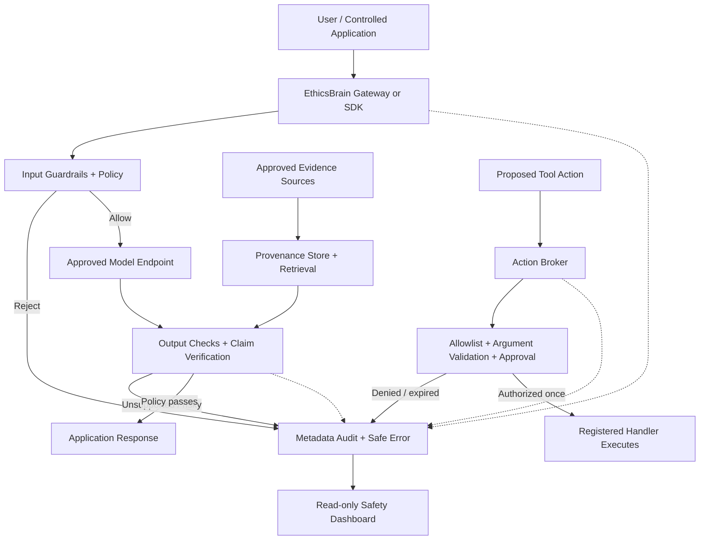

# EthicsBrain v1.0.0 🧠🛡️

**An integrated, provider-neutral AI safety and governance framework for applications you control.**

EthicsBrain combines request/response guardrails, a reference model gateway, claim-to-evidence verification, provenance-tracked retrieval, a governed action broker, tamper-evident audit logging, repeatable benchmarks, and a local monitoring dashboard in one Python project.

> **Honest scope:** No software layer can control an AI model that is used outside systems it administers, and no detector can guarantee zero hallucinations or zero unsafe behavior. EthicsBrain can enforce decisions only on routes and registered actions that the host application actually sends through it. The included model gateway and dashboard are local development/reference services, not hardened public-internet services.

## Capabilities

| Area | Included capability | Important boundary |
|---|---|---|
| Input safety | Selected prompt-injection, high-risk request, secret-like token, identifier, length, and repetition checks | Built-in detectors are pattern based and have false positives/negatives |
| Output safety | Output length, sensitive-data patterns, citation syntax/ID checks, custom fail-closed evaluator hooks | Pattern checks do not understand every unsafe context |
| Evidence verification | Per-claim statuses: supported, contradicted, conflicting, insufficient, missing/invalid citation, unverified, abstained | Semantic evaluator scores are not proof or calibrated probabilities unless validated |
| Retrieval provenance | Version-preserving local document store, stable chunk IDs, source metadata, SHA-256 hashes, text offsets, lexical retrieval | Hashes establish byte-level consistency, not publisher authenticity or truth |
| Action governance | Explicit handler registry, action allowlist, denylist, argument validator, time-limited approval workflow, replay prevention, single execution state | Host must supply real identity/authentication for human approvers and avoid bypassing the broker |
| Model gateway | OpenAI-compatible, non-streaming text endpoint with bearer token, pinned upstream model, role restrictions, request limits, output guardrails | Does not intercept other apps; no streaming, image input, or tool-call passthrough |
| Audit | Minimal JSONL metadata with hash-chain links and an audit verifier | Replacing the whole log and recomputing hashes is possible without an externally anchored checkpoint |
| Monitoring | Local read-only dashboard for audit metadata, log-chain status, evidence integrity, and benchmark reports | No authentication/TLS; bind to loopback only unless hardened |
| Evaluation | Safety, claim-verification, and retrieval benchmark runners with JSON/Markdown reports | Included datasets are synthetic smoke/regression sets, not real-world safety evidence |
| Policy management | Validated JSON policy load/save and CLI validation | Configuration still needs review, version control, deployment testing, and change management |

## Architecture



The gateway intentionally rejects client-provided system/developer/tool messages, streaming, multimodal payloads, and tool calls. Registered actions are handled separately by `ActionBroker` so model-generated tool requests are never executed directly by the gateway.

## Install and test

Requires Python 3.10 or newer. Core runtime has no third-party dependencies.

```powershell
py -m venv .venv
.\.venv\Scripts\Activate.ps1
python -m pip install --upgrade pip
python -m pip install -e .
python -m unittest discover -s tests -v
```

Run the smoke/regression benchmarks:

```powershell
python -m ethicsbrain.benchmark --out-dir reports/benchmark
python -m ethicsbrain.retrieval_benchmark --out-dir reports/retrieval
python -m ethicsbrain.policy_cli validate configs/policy.example.json
```

The semantic verification benchmark additionally needs the optional NLI dependencies and downloaded model: install with `python -m pip install -e ".[nli]"`, then run `python -m ethicsbrain.verification_benchmark --out-dir reports/verification`. The standard CI workflow runs the unit tests and built-in safety/retrieval smoke benchmarks on Python 3.10, 3.11, and 3.12.

## Quick start: protect a model call

```python
from ethicsbrain import GuardrailBrain, ModelRequest, Policy

# Replace with a real local/hosted provider adapter; this stub keeps the example free.
def my_model(request: ModelRequest) -> str:
    source = request.context.get("E1", "")
    return f"The supplied source states: {source} [E1]"

policy = Policy(grounding_mode="strict", allowed_actions={"search_docs"})
brain = GuardrailBrain(policy=policy, audit_log_path="logs/audit.jsonl")
result = brain.run(
    "Summarize the source.", my_model,
    context={"E1": "EthicsBrain checks model inputs and outputs through middleware."},
)
print(result.ok, result.text)
print(result.report.to_dict())
```

The callback receives a `ModelRequest` and must return text. Keep trusted evidence in a separate dictionary using stable IDs such as `E1`. `grounding_mode="strict"` checks citations and evidence IDs; it does **not** prove the cited source entails the claim. Use semantic claim verification for a stricter factual pipeline.

## Semantic claim verification

Core verification parses citation IDs and returns an unverified result if no evaluator is configured. An optional local NLI evaluator uses Transformers/PyTorch:

```powershell
python -m pip install -e ".[nli]"
```

```python
from ethicsbrain import verify_response
from ethicsbrain.nli import TransformersNliEvaluator

evaluator = TransformersNliEvaluator(
    model_name="cross-encoder/nli-deberta-v3-small",
    device=-1,  # CPU; local model files are downloaded/cached on first use
    entailment_threshold=0.70,
    contradiction_threshold=0.70,
    minimum_margin=0.15,
)
report = verify_response(
    "The sample has a temperature of 500 K [E1].",
    {"E1": "Measurements report a temperature of 500 K for the sample."},
    evaluator,
    minimum_confidence=0.75,
)
print(report.to_dict())
```

NLI is an evidence-support estimator, not a universal truth detector. Validate thresholds against a domain-specific labeled set, include contradictory/ambiguous cases, and use human review for consequential outputs. See [`docs/VERIFICATION.md`](docs/VERIFICATION.md).

## Govern external actions with `ActionBroker`

Unlike the simple `GuardrailBrain.authorize_action()` advisory method, `ActionBroker` keeps registered handlers behind one API and enforces proposal expiry, human approval, argument validation, and one-time execution. This is still application-level enforcement: do not expose the raw handler elsewhere in your code.

```python
from ethicsbrain import ActionBroker, ActionRequest, Policy

policy = Policy(allowed_actions={"search_docs", "send_email"})

# Integrate this callback with your actual authenticated user/approval system.
def authenticate_approval(approver_id, action, proof):
    return approval_service.verify(approver_id, action, proof)

broker = ActionBroker(
    policy,
    approval_authorizer=authenticate_approval,
    audit_log_path="logs/audit.jsonl",
    proposal_ttl_seconds=300,
)

broker.register(
    "search_docs",
    handler=lambda args: search_document_index(args["query"]),
    validate_arguments=lambda args: isinstance(args.get("query"), str) and len(args["query"]) <= 500,
)
broker.register(
    "send_email",
    handler=lambda args: send_email(args["to"], args["subject"], args["body"]),
    validate_arguments=lambda args: all(isinstance(args.get(k), str) for k in ("to", "subject", "body")),
)

proposal = broker.propose(ActionRequest("search_docs", {"query": "retention policy"}))
if proposal.status == "ready":
    result = broker.execute(proposal.proposal_id)  # can execute only once

email_proposal = broker.propose(ActionRequest("send_email", {
    "to": "person@example.test", "subject": "Review", "body": "Draft only"
}))
if email_proposal.status == "awaiting_approval":
    # Show the exact action to a real user. Authenticate their decision in your host app.
    proof = approval_service.request_human_confirmation(email_proposal.to_dict())
    broker.approve(email_proposal.proposal_id, approver_id=current_user.id, proof=proof)
    broker.execute(email_proposal.proposal_id)
```

The `approval_service`, `search_document_index`, `send_email`, and `current_user` symbols above are application-specific placeholders, not included services. Do not use a permissive `lambda *_: True` approval callback in production. If no approval authorizer is configured, sensitive actions remain unapproved. Actions on the explicit denylist cannot be approved. A handler exception is recorded as a sanitized failure, and the proposal cannot be replayed.

See [`docs/ACTION_GOVERNANCE.md`](docs/ACTION_GOVERNANCE.md) for the trust boundary and lifecycle.

## JSON policy configuration

Start from [`configs/policy.example.json`](configs/policy.example.json). The example uses `grounding_mode: "strict"` and only allowlists two read-only actions; update the action names carefully for your application.

```python
from ethicsbrain import Policy
policy = Policy.from_json("configs/policy.example.json")
policy.save_json("configs/policy.local.json")
```

Validate it from the terminal:

```powershell
python -m ethicsbrain.policy_cli validate configs/policy.example.json
```

Create a fresh default policy file:

```powershell
python -m ethicsbrain.policy_cli create-default configs/policy.local.json
```

Default policies have an empty action allowlist. Review policy changes and keep them in version control; never put API keys or secrets in policy JSON.

## Model enforcement gateway (reference server)

A small OpenAI-compatible reference gateway is available for controlled applications. It supports **non-streaming, text-only** `POST /v1/chat/completions` requests.

Windows PowerShell example (start your upstream model server first):

```powershell
$env:UPSTREAM_BASE_URL = "http://localhost:11434/v1"
$env:UPSTREAM_MODEL = "llama3.2"
$env:ETHICSBRAIN_GATEWAY_TOKEN = (python -c "import secrets; print(secrets.token_urlsafe(32))")
$env:ETHICSBRAIN_BIND = "127.0.0.1"
$env:ETHICSBRAIN_PORT = "8088"
python -m ethicsbrain.gateway
```

Clients call `http://127.0.0.1:8088/v1/chat/completions` with `Authorization: Bearer <gateway token>`. Store provider credentials and the gateway token only on a trusted server. Configure upstream API keys via environment variables as needed.

The gateway pins the upstream model and URL, owns the system prompt, rejects privileged client roles, rejects tool calls/streaming/multimodal payloads, enforces request/response size limits, and passes requests through `GuardrailBrain`.

**It does not intercept other applications automatically.** To reduce bypass in an environment you own, avoid distributing upstream credentials to clients, use managed network egress controls to restrict direct provider access, and configure all workloads to use the gateway. Binding `127.0.0.1` only protects the local interface; a shared deployment additionally needs TLS, authentication/authorization, rate limits, concurrency limits, secrets management, monitoring, patching, and production-grade server infrastructure. This reference `http.server` implementation is not hardened for the public internet.

## Evidence provenance and retrieval

The local evidence store keeps source metadata, retrieval timestamps, document/chunk SHA-256 hashes, version history, stable citation IDs, and character offsets. It uses a transparent lexical ranking method and can generate context/source cards for claim verification.

```powershell
python -m ethicsbrain.provenance --help
python -m ethicsbrain.retrieval_benchmark --out-dir reports/retrieval
```

See [`docs/PROVENANCE.md`](docs/PROVENANCE.md). Hash integrity detects accidental/tampered content relative to stored hashes; it does not establish that a publisher is genuine, that the source is current, or that its claims are true.

## Audit log integrity

When configured, the logger stores minimal metadata, truncated SHA-256 fingerprints of prompt/output, decision and rule IDs, prior-event hash, and event hash. It omits raw prompt/response content by default. Hashes are not anonymization; protect the logs and omit fingerprints if your threat model requires it.

Verify a new v1.0-format log:

```powershell
python -m ethicsbrain.audit_cli logs/audit.jsonl
```

The audit chain detects record modifications as long as you trust an external checkpoint. An attacker able to replace the entire file and recompute every hash can defeat an unanchored chain, so periodically store the final hash in a separate trusted logging system. Existing pre-v1.0 logs lack chain fields and will be reported as legacy/unverifiable; archive them and start a new log to enable full-chain checks.

## Dashboard

```powershell
python -m ethicsbrain.dashboard `
  --audit logs/audit.jsonl `
  --reports-dir reports `
  --evidence-store data/evidence_store.json `
  --host 127.0.0.1 `
  --port 8765
```

Open <http://127.0.0.1:8765>. The dashboard is read-only and does not display raw prompts or responses. It shows decisions, hash-chain status, evidence integrity, indexed source metadata, and benchmark reports. It has no authentication or TLS; keep it local unless you harden it.

## Benchmarks and evaluation discipline

Included synthetic suites test known regressions and exercise metric generation. They are intentionally small and must not be presented as representative real-world performance. Replace or supplement them with independently reviewed benign and adversarial examples, hold out a test set, measure false accepts/blocks and latency, and rerun benchmarks when rules/models/configurations change.

```powershell
python -m ethicsbrain.benchmark --out-dir reports/benchmark
python -m ethicsbrain.retrieval_benchmark --out-dir reports/retrieval
python -m ethicsbrain.verification_benchmark --out-dir reports/verification
```

## Test coverage

See [`docs/VALIDATION_RESULTS.md`](docs/VALIDATION_RESULTS.md) for the exact checks performed for this release, including test environment and limits. The suite includes model guardrails, gateway HTTP integration with a simulated upstream, provenance integrity, retrieval/verifier benchmarks, NLI threshold behavior with mocked scores, JSON policy validation, hash-chain tamper checks, and action broker approval/replay/expiry paths. Tests use mock/synthetic endpoints and **do not mean the framework has been validated against a live provider or deployed production traffic**.

## Security notes

- Keep the core gateway/dashboard bound to loopback for local development.
- Never commit `.env`, provider keys, real customer data, or live audit logs.
- Do not use an LLM-as-judge as the only gate for high-impact decisions.
- Keep tool handlers private and run them with least-privilege credentials.
- Human approval identity must be authenticated by the host system; the broker intentionally delegates identity verification to `approval_authorizer`.
- Apply sandboxing and network/OS permissions outside Python for commands or tools with dangerous capabilities.
- See [`SECURITY.md`](SECURITY.md) and [`docs/THREAT_MODEL.md`](docs/THREAT_MODEL.md).

## License

MIT — see [LICENSE](LICENSE).
