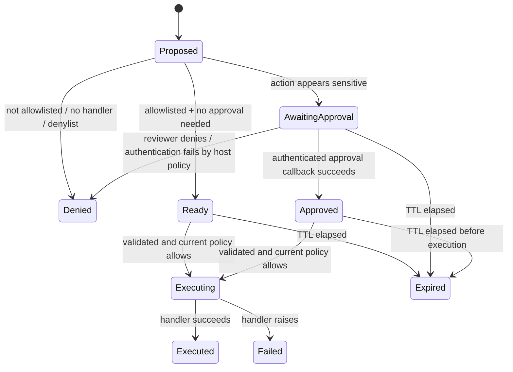

# Action governance and execution boundary

`GuardrailBrain.authorize_action()` returns a decision for a host application to enforce. The consolidated `ActionBroker` adds a registered-handler layer for applications that want the framework to own the action routing path.

## State machine



## Required host responsibilities

- Configure `Policy.allowed_actions` explicitly and register only those handler names.
- Keep raw handlers private. Do not also expose the underlying function, database client, shell, email service, or credentials through an unguarded route.
- Provide an `approval_authorizer(approver_id, action, proof)` callback backed by a real authenticated identity and an approval record bound to the exact proposed action. If no callback is configured, sensitive actions cannot be approved.
- Treat action arguments as untrusted. Supply a strict `validate_arguments` callback for each registered handler; validate destination/tenant/resource scope, data types, sizes, and business logic.
- Run handlers with least privilege. For shell-like actions, isolate the process, restrict filesystem/network access, and use fixed executable/argument schemas instead of interpolating model-generated strings.
- Treat outputs/results as untrusted too. A broker only governs whether a handler may run; it does not prove that the handler's result is safe or correct.
- Monitor failed/expired proposals and authorization denials without writing secrets or raw sensitive arguments to logs.

## Example

```python
from ethicsbrain import ActionBroker, ActionRequest, Policy

policy = Policy(allowed_actions={"search_docs", "send_email"})

def authenticated_approval(approver_id, action, proof):
    # Delegate to your trusted identity/approval service. This is not a stub to skip.
    return approval_service.verify_action_approval(
        approver_id=approver_id,
        action_name=action.name,
        action_digest=trusted_digest(action),
        proof=proof,
    )

broker = ActionBroker(policy, approval_authorizer=authenticated_approval)
broker.register(
    "search_docs",
    search_docs,
    validate_arguments=lambda args: isinstance(args.get("query"), str) and len(args["query"]) <= 500,
)
proposal = broker.propose(ActionRequest("search_docs", {"query": "policy"}))
if proposal.status == "ready":
    documents = broker.execute(proposal.proposal_id)
```

The `approval_service`, `trusted_digest`, and `search_docs` functions above belong to the host app. Use the broker's stored proposal details to bind approval to the exact action; the sample `trusted_digest` call illustrates the idea rather than naming an API in this library.

## Limits

The broker is a Python application component, not an operating-system security boundary. Python code in the same process may still access arbitrary resources if the application exposes them. A malicious application can bypass the broker by using an unguarded path or calling a handler directly. Use process isolation and host/network permissions for stronger enforcement. In-memory proposals do not survive process restarts, and a multi-instance service needs shared durable proposal/approval state plus a transactional execution/idempotency store before relying on this workflow across workers.
